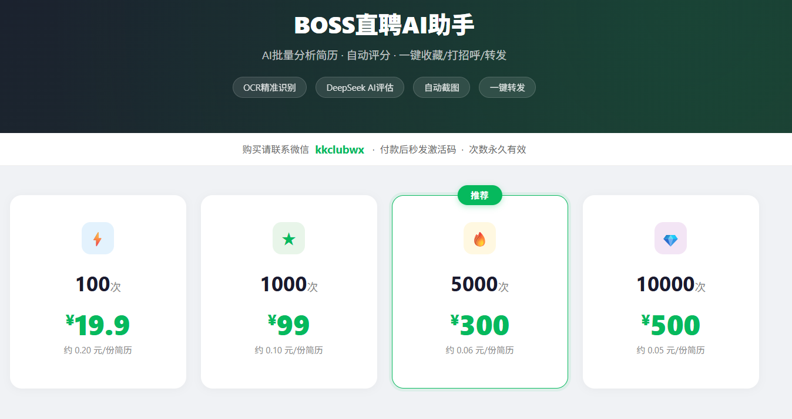

# BOSS直聘AI助手 Pro版 使用说明

## 一、安装

1. 打开 谷歌 Chrome 浏览器，地址栏输入 `chrome://extensions/` 或 按照录像所示的方法
2. 右上角开启**开发者模式**
3. 点击**加载已解压的扩展程序**
4. 选择 `dist` 文件夹
5. 安装完成，浏览器右上角出现插件图标

## 二、激活

首次安装赠送 **10 次免费试用**，用完需要购买激活码。

1. 点击插件图标 → 弹出设置面板
2. 在底部 **Pro 激活码** 输入框粘贴激活码
3. 点击 **激活** 按钮
4. 激活成功后显示剩余次数

> 购买激活码请联系微信 **kkclubwx**，价格：`https://score.rzcf.com:4433/score/score-api/boss/pricing`

加微信赠送50次试用数量

## 三、使用场景

支持三个页面：

| 页面 | 入口 | 地址 |
|------|------|------|
| 搜索简历 | BOSS直聘 → 人才库 | `zhipin.com/web/chat/search` |
| 推荐牛人 | BOSS直聘 → 推荐牛人 | `zhipin.com/web/chat/recommend` |
| 沟通页面 | 暂不支持 | - |

### 3.1 搜索简历 / 推荐牛人

1. 进入对应页面
2. 点击插件图标，配置参数：
   - **系统提示词**：AI 评估标准（可选模板）
   - **过滤已读简历**：勾选后自动跳过已浏览的灰色卡片
   - **评分阈值**：达标分数线（默认80分）
   - **自动收藏**：分数达标自动收藏
   - **自动联系Ta**：分数达标自动发送打招呼
   - **自动转发至邮箱**：分数达标自动转发简历到指定邮箱
   - **未达标仍获取分享卡片**：即使分数不够也截取分享图
3. 点击 **保存设置**，然后点击 **立即开始**
4. 插件自动逐份打开简历 → 截图 → AI 评分 → 执行自动动作
5. 结果面板显示所有分析记录，可导出 HTML/Excel

## 四、结果操作

| 操作 | 说明 |
|------|------|
| 仅显示达标简历 | 过滤低分结果 |
| 下载 HTML | 导出分析报告（网页格式） |
| 导出 Excel | 导出分析数据表格 |
| 清空结果 | 删除当前显示记录 |
| 备份 / 恢复 | 备份分析数据到文件，或从文件恢复 |

时间筛选支持：今天、昨天、近7天、近30天、全部。

## 五、注意事项

1. **不要手动操作页面**：AI 分析过程中请勿点击页面，避免干扰自动化流程
2. **每日限制**：浏览 100 份/天，转发邮件 100 次/天
3. **推荐牛人页面**：分析时请保持在推荐牛人标签页，不要切走
4. **快捷键**：按 `ESC` 可随时停止分析

## 六、常见问题

**Q: 显示"次数已用完"？**
A: 试用次数用完或激活码次数耗尽，联系微信 kkclubwx 购买新激活码。

 

**Q: 分享卡片不对？**
A: 正常现象，切页面后第一个人偶尔串卡，第二个开始正常。

**Q: 评分不准确？**
A: 可在插件设置中修改**系统提示词**，调整 AI 评估标准。
